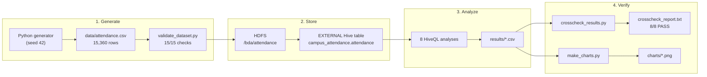

# BDA Campus Attendance Analytics

<p align="center">
  <strong>HDFS + Apache Hive + Python</strong><br/>
  <em>Synthetic campus attendance analytics with real HiveQL execution and independent verification.</em>
</p>

<p align="center">
  
  
  
  
  
  
</p>

> All data is synthetic and anonymised. No real student information is used.

## At a Glance

| Metric | Value |
|---|---|
| Attendance records | **15,360** |
| Students | **480** |
| Subject offerings | **80** |
| Departments | CSE, ISE, ECE, EEE, ME |
| Overall attendance | **74.95%** |
| HiveQL analyses | **8** |
| Dataset validation | **15/15 PASS** |
| Hive cross-check | **8/8 PASS** |

## Architecture



The pipeline is orchestrated by `campus-attendance-hive/run.sh`: generate, validate, upload to HDFS,
create the Hive table, run the analytics, cross-check the results, and build the charts.

## What This Project Demonstrates

- A reproducible dataset of **15,360 attendance records** for **480 students**.
- Upload of the CSV into **HDFS at `/bda/attendance`**.
- An **EXTERNAL Hive table** `campus_attendance.attendance`.
- Eight HiveQL analyses: overall, subject, student, low-attendance, department, section,
  daily trend, and weekly trend.
- Hive results saved as CSV files in `campus-attendance-hive/results/`.
- Independent Python cross-check of every Hive result (**8/8 comparisons pass**).
- Charts generated only from the Hive output CSVs.
- Report evidence, screenshots, runbook, and viva/demo preparation material.

## Repository Layout

```text
BDA-ABA/
├── campus-attendance-hive/          # Main project: data, HiveQL, Docker, scripts, results
│   ├── data/attendance.csv          # 15,360 synthetic records
│   ├── docker/                      # HDFS + Hive + PostgreSQL metastore
│   ├── hive/                        # Table DDL and eight HiveQL queries
│   ├── scripts/                     # Generate, validate, cross-check, chart, summarise
│   ├── results/                     # Hive output, validation reports, execution evidence
│   ├── charts/                      # Charts built from Hive results
│   ├── screenshots/                 # HDFS UI captures
│   └── run.sh                       # End-to-end runner
├── ENVIRONMENT.md                   # Detected host/tool versions and runtime decision
├── Campus_Attendance_Hive_Implementation_Guide.md
├── Campus_Attendance_Hive_Simple_Explanation_Demo_Guide_Viva_Prep.md
├── Campus_Attendance_Hive_Live_Demo_Notes_opencode-style.md
├── Campus_Attendance_Hive_Copilot_Agent_Prompt.md
├── BDA_Campus_Attendance_Sample_Report.docx
├── BDA_Campus_Attendance_Sample_Report.pdf
└── Campus-Attendance-Trend-Analytics-Using-Apache-Hive-on-the-Hadoop-Ecosystem.pptx
```

The full project documentation is in
[campus-attendance-hive/README.md](campus-attendance-hive/README.md).

## Prerequisites

- Python 3.10+ with `pandas`, `numpy`, and `matplotlib`
- Docker Desktop with the Linux container engine running
- Docker Compose v2+
- About 5 GB free disk for the first image pull
- Internet access on the first run

Tested environment: Windows 11, Git Bash, Python 3.14.3, Docker 29.8.0, Compose v5.5.1.
See [ENVIRONMENT.md](ENVIRONMENT.md) for details.

## Quick Start

```bash
cd campus-attendance-hive
chmod +x run.sh
./run.sh
```

`run.sh` performs the complete workflow:

1. Generate and validate the dataset.
2. Start the HDFS/Hive Docker stack.
3. Create `/bda/attendance` and upload the CSV.
4. Create `campus_attendance.attendance`.
5. Verify with `SHOW TABLES`, `DESCRIBE`, `LIMIT`, and `COUNT(*)`.
6. Execute the eight HiveQL analyses.
7. Cross-check every result with Python.
8. Generate charts and the key-findings summary.

If Hadoop/Hive are already installed natively, run:

```bash
MODE=native ./run.sh
```

On Windows/Git Bash, `run.sh` sets `MSYS_NO_PATHCONV=1` and `MSYS2_ARG_CONV_EXCL='*'`
automatically so container paths are not rewritten.

## Reinstall / Environment Reset

There are no committed `node_modules` or Python virtual-environment folders. Use the system
Python and install the required packages with:

```bash
pip install pandas numpy matplotlib
```

Docker images are pulled automatically on the first `./run.sh`. To stop the stack:

```bash
docker compose -f campus-attendance-hive/docker/docker-compose.yml stop
```

To remove containers but keep HDFS data volumes:

```bash
docker compose -f campus-attendance-hive/docker/docker-compose.yml down
```

To fully reset and delete the HDFS volumes:

```bash
docker compose -f campus-attendance-hive/docker/docker-compose.yml down -v
```

After a full reset, `./run.sh` recreates the HDFS directory, uploads the CSV, and recreates the
Hive table.

## Outputs

| Output | Location |
|---|---|
| Synthetic dataset | `campus-attendance-hive/data/attendance.csv` |
| Hive result CSVs | `campus-attendance-hive/results/*.csv` |
| Validation and cross-check reports | `campus-attendance-hive/results/*.txt` |
| Charts | `campus-attendance-hive/charts/*.png` |
| HDFS UI screenshots | `campus-attendance-hive/screenshots/*.png` |
| Key findings | `campus-attendance-hive/results/key_findings.md` |

## Documentation

| Document | Purpose |
|---|---|
| [Project README](campus-attendance-hive/README.md) | Full project details, results, and step-by-step commands |
| [RUNBOOK](campus-attendance-hive/RUNBOOK.md) | Setup, operation, troubleshooting, and demo sequence |
| [Environment report](ENVIRONMENT.md) | Detected tools and Docker runtime decision |
| [Report evidence](campus-attendance-hive/docs/REPORT_EVIDENCE.md) | Mapping to the report sections |
| [Screenshot checklist](campus-attendance-hive/SCREENSHOT_CHECKLIST.md) | Remaining manual evidence captures |
| [Implementation guide](Campus_Attendance_Hive_Implementation_Guide.md) | Build plan and acceptance criteria |
| [Viva preparation](Campus_Attendance_Hive_Simple_Explanation_Demo_Guide_Viva_Prep.md) | Explanation and demo preparation |
| [Live demo notes](Campus_Attendance_Hive_Live_Demo_Notes_opencode-style.md) | Demo walkthrough notes |

## Team

| Name | USN |
|---|---|
| Bharath Krishna K K | 4VV23CS033 |
| Charan P | 4VV23CS042 |
| Abu Safwan | 4VV23CS006 |

## Notes

- Hadoop/Hive run in Docker because no native Hadoop/Hive installation is available on the
  tested Windows host. The containers use Hadoop 2.7.4 and Hive 2.3.2.
- No YARN cluster is used; Hive runs MapReduce in local mode inside the HiveServer2 container.
- The `.txt`, `.csv`, `.err`, and `.log` files under `results/` are execution evidence and are
  intentionally kept.
